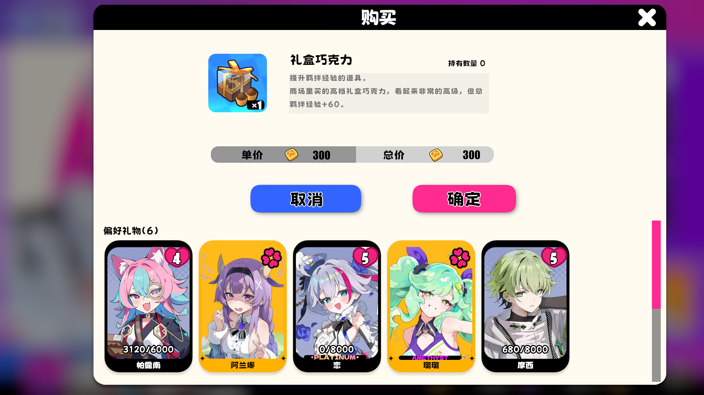
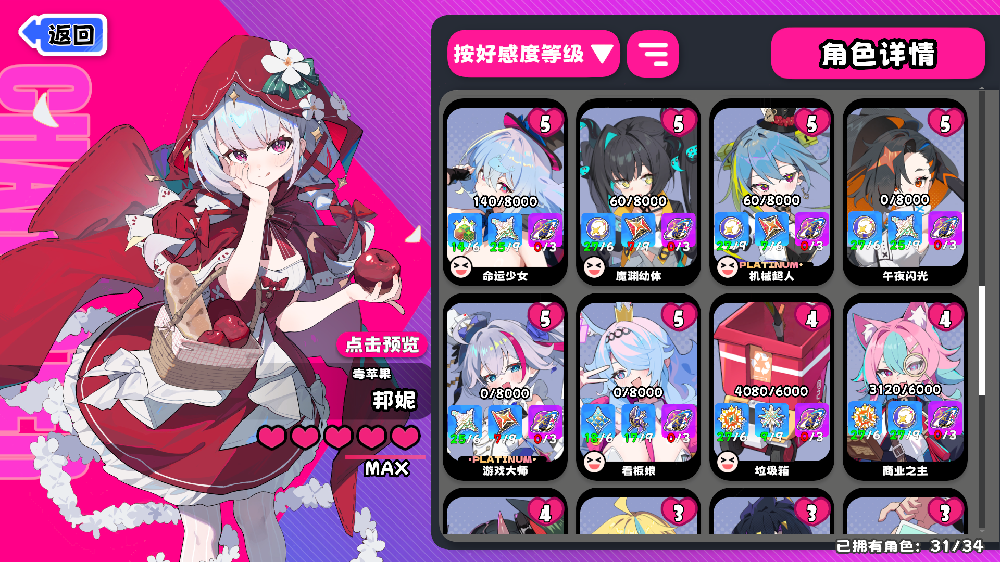

# 礼物指南（GiftGuide）

在《吉星派对》中查看礼物和培养材料时，直接找到需要它们的角色，轻松了解友情进度与材料是否足够。

## 功能详情

### 打开道具，就能看到哪些角色需要它

在**物品详情、购买窗口和自选道具窗口**中，自动显示与当前道具相关的角色列表。选择不同的自选奖励时，列表也会跟着切换，不用再来回打开角色界面查找。

角色按照道具用途分为 **契约、潜能、偏好礼物** 三类。列表支持滚动查看，方便同时比较多名角色；显示区域会根据窗口调整，尽量不影响原有的物品说明和操作按钮。

### 一眼看清材料还差多少

- **缔结契约**：查看哪些角色需要当前材料，以及每种材料已拥有和需要的数量。材料足够时，拥有数量显示为绿色；不足时显示为红色。已经缔结契约的角色会显示完成标识，不再重复列出契约材料。
- **潜能激发**：查看角色激发潜能需要的材料。即使材料已经集齐，材料列表也会保留，方便核对；已完成潜能激发的角色会显示对应标识。
- **偏好礼物**：查看喜欢当前礼物的角色以及当前友情经验，经验以“当前经验/升级所需经验”的形式展示。已完成友情加深的角色会显示完成标识。

角色卡片还会展示相应的友情等级或 PVE 等级。未拥有的角色以黑白效果显示，不会展示友情经验，方便与已拥有角色区分。

### 在角色界面也能查看培养进度

打开角色界面并切换排序方式后，可以直接在角色卡片上查看对应信息：

- **按友情等级排序**：显示尚未缔结契约的角色所需材料；尚未友情加深时，还会显示当前友情经验。
- **按 PVE 等级排序**：显示尚未激发潜能的角色所需材料，即使材料已经集齐也能继续查看。
- **默认排序**：不额外显示材料和经验，保持原本的简洁界面。

另外，当背包中有角色偏好的礼物时，角色配置界面的卡片也会提供相应提示。

### 尽量保持游戏原有的界面风格

角色列表沿用游戏里的角色头像、品质标识和状态图标，搭配可拖动的粉红色滚动条。新增信息尽量放在角色卡片附近，便于查看；关闭相关窗口后，窗口布局会恢复原状。

## 安装与编译

本 Mod 使用 [CesiumLoader](https://github.com/higashitaniyume/CesiumLoader) 加载。

如果下载的是**已编译版本**，请按照 CesiumLoader 的 Mod 安装说明，将文件放入对应的 Mod 目录，并重新启动游戏。

如果下载的是**源码**，请使用项目中的 `GiftGuide.csproj` 构建；编译时需要与当前游戏版本相匹配的 CesiumLoader SDK、Unity、FairyGUI 和游戏程序集。
